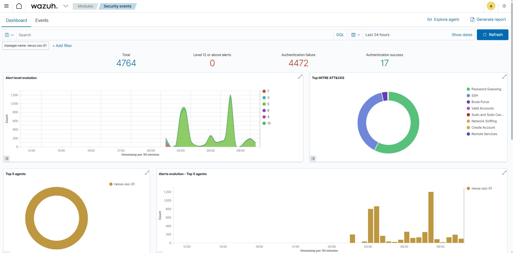
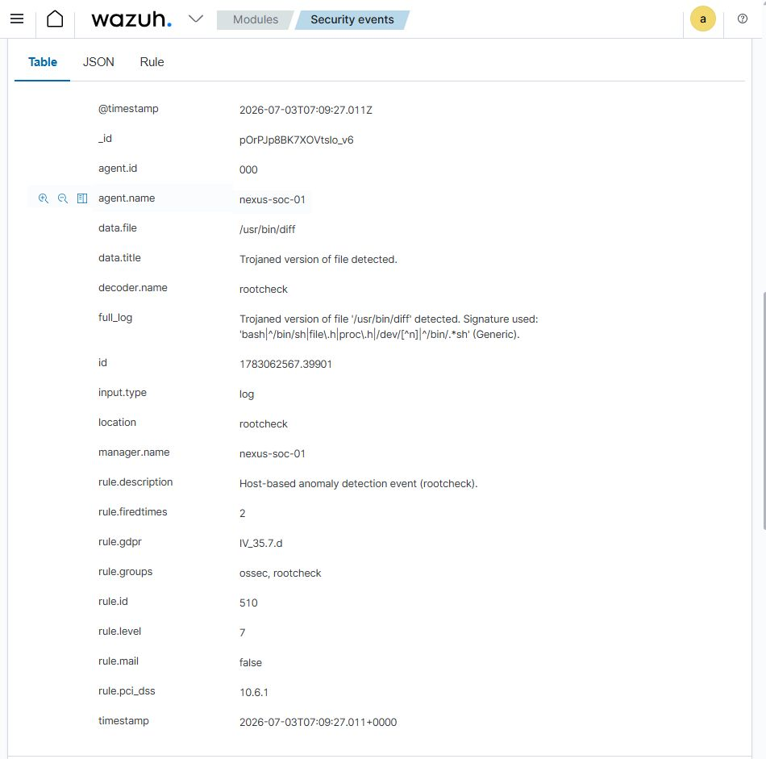

# Cybersecurity Portfolio

Hands-on cybersecurity work: detection, investigation, and network defense —
documented with evidence, not just claims.

## Project Overview

- **Cloud-based SOC lab.** A working blue-team lab built around **Wazuh SIEM/XDR**
  (the Nexus Freight home lab), used to practice security monitoring, alert triage,
  and incident investigation with a repeatable process — not just tooling.
- **Repeatable investigation framework.** Every alert runs through the same four
  steps — Categorize → Verify → Respond → Document — so verdicts come from evidence
  instead of gut feeling. Field-tested on a live alert.
- **Real investigation, fully documented.** Wazuh rule 510 flagged `/usr/bin/diff`
  as trojaned (level 7). The full framework ran: three verification checks,
  community threat intel, and a false positive declared with the evidence attached.

## Lab Environment

| Component | Detail |
|---|---|
| SIEM / XDR | Wazuh (manager + dashboard) |
| Monitored host | `nexus-soc-01` (Wazuh manager name; single-agent lab) |
| Lab name | Nexus Freight home lab |
| Time window shown | Last 24 hours |

## The Alert Investigation Framework

Status: v0.1 — field-tested 2026-09-28. Full document:
[soc-operations/wazuh-soc-lab/docs/alert-investigation-framework.md](soc-operations/wazuh-soc-lab/docs/alert-investigation-framework.md).

1. **Categorize** — understand what the flagged artifact is, who should ever
   legitimately touch it, and the blast radius if the alert is real.
2. **Verify** — no verdict without evidence; all three checks must agree:
   local logs, local integrity check against the known-good package, and
   external threat intel.
3. **Respond** — false positive: declare it with the evidence attached and prefer
   hash-based suppression; never disable the rule entirely (no trading noise for
   blindness). True-positive branch documented for completeness (contain →
   eradicate/recover); not yet exercised in this lab.
4. **Document** — log the alert, the evidence checked, the verdict, and the
   rationale; feed takeaways back into detection tuning.

Field test log: 2026-09-28 — Wazuh rule 510, trojaned `/usr/bin/diff`, level 7 →
**false positive** (known overly-broad rootcheck regex signature,
[wazuh/wazuh#19346](https://github.com/wazuh/wazuh/issues/19346)).

## Investigation Walkthrough — Trojaned `/usr/bin/diff` (2026-09-28)

Verdict: ✅ **False positive**. Full write-up:
[soc-operations/wazuh-soc-lab/investigations/2026-09-28-trojaned-usr-bin-diff-false-positive.md](soc-operations/wazuh-soc-lab/investigations/2026-09-28-trojaned-usr-bin-diff-false-positive.md).

The alert: Wazuh rule 510 (rootcheck — host-based anomaly detection) fired a
level 7 alert on agent `nexus-soc-01`: trojaned version of `/usr/bin/diff`
detected. A trojaned system binary is a scary alert — if real, anything executing
`diff` runs attacker code — which is exactly why it went through the full
framework instead of a gut call.

Dashboard context at investigation time: 4,764 total events, 4,472 authentication
failures, zero level-12+ alerts — a noisy environment where triage discipline
matters. The MITRE ATT&CK view is dominated by Password Guessing and SSH activity.

Verification — all three checks ran and agreed:

1. **Local package logs** — no recent updates or installs touching `diff`; nothing
   explained a modification.
2. **Local integrity check** — checked against the known-good package; the file
   came back clean.
3. **External threat intel** — VirusTotal: 0/63 detections; community reports
   confirmed the known false positive from the overly-broad rootcheck regex.

Response: false positive declared with evidence. Hash-based suppression would be
ideal, but Wazuh's rootcheck module doesn't support it — and disabling rule 510
entirely was rejected as too risky. Decision: accept the alert and save the clean
SHA256 hash for future comparison.

Takeaway: a high-severity alert does not always mean an actual crisis. The level 7
looked alarming; the evidence said otherwise. *A repeatable process is what
separates the signal from the noise.*

## Repository Map

- [soc-operations/wazuh-soc-lab/](soc-operations/wazuh-soc-lab/) — lab README,
  environment details, and the investigation index.
- [soc-operations/wazuh-soc-lab/docs/alert-investigation-framework.md](soc-operations/wazuh-soc-lab/docs/alert-investigation-framework.md) —
  the four-step triage process.
- [soc-operations/wazuh-soc-lab/investigations/](soc-operations/wazuh-soc-lab/investigations/) —
  full investigation write-ups with raw alerts, evidence, verdicts, and reasoning.
- [soc-operations/wazuh-soc-lab/screenshots/](soc-operations/wazuh-soc-lab/screenshots/) —
  annotated evidence backing each investigation.

## Standards

- Screenshots are evidence, annotated with what each one proves.
- Only what's actually built and validated gets claimed.
- Sanitized: no passwords, keys, tokens, or real public IPs — ever.
